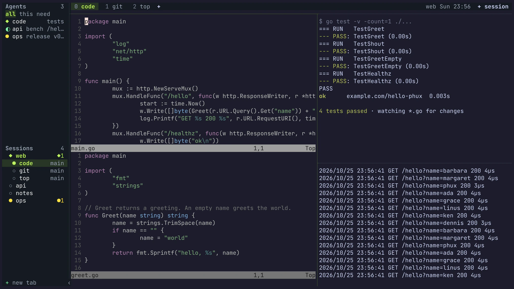
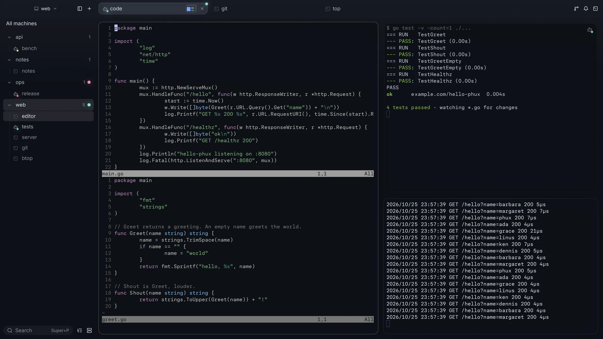
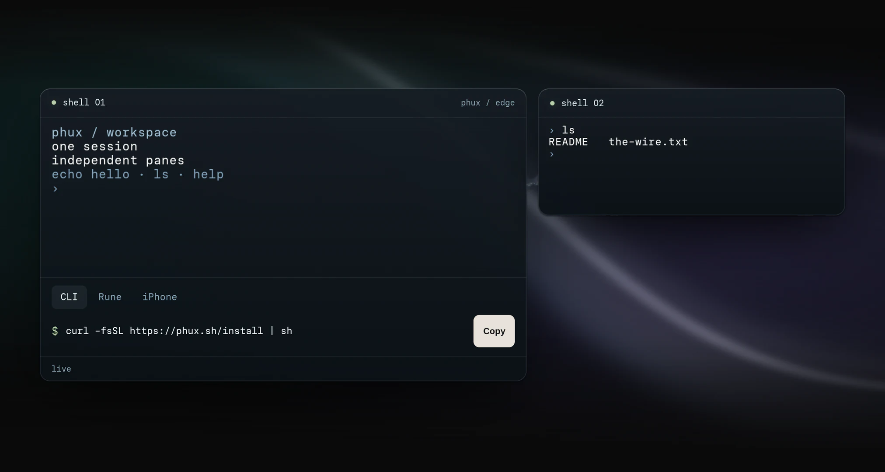
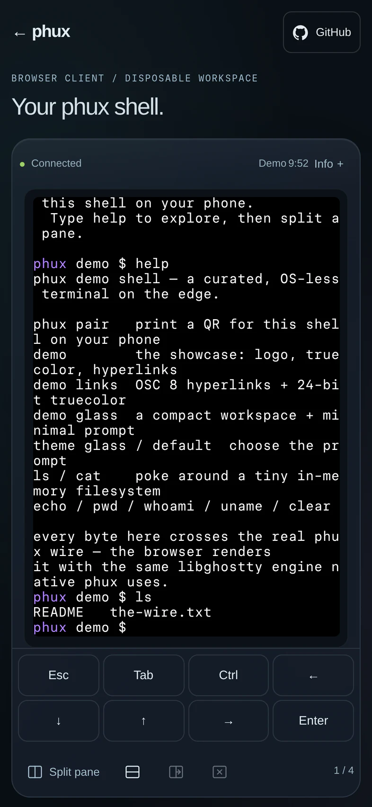

<p align="center">
  
</p>

<p align="center">
  Oh good, another terminal multiplexer for agents.<br>
  This one gives a phux.
</p>

<p align="center">
  <a href="https://docs.phux.sh">Docs</a> ·
  <a href="#install">Install</a> ·
  <a href="https://phux.sh">Try it in a browser</a> ·
  <a href="https://discord.gg/dUv5rzdHp">Discord</a>
</p>



phux keeps your shells running in a background server, the way tmux does.
The server also knows which panes run a coding agent, and whether each one is
working, idle, or waiting on you. Everything the terminal UI does, a command
can do too, with JSON output and exit codes.

It runs on your machines. There is no account and no hosted service.

## Install

```sh
curl -fsSL https://phux.sh/install | sh
phux
```

`Ctrl-A` `d` detaches. Your shells keep running; `phux` brings you back to
them. Homebrew works too: `brew install no-phux/tap/phux`.

macOS on Apple silicon, Linux on x86_64 or arm64, and Windows through WSL 2.
[Every install option](./docs/install.md), including the
[desktop app](./clients/rune/README.md).

## One server, every screen

The server owns the terminals. Anything that connects is a client, and they
all show the same sessions at once. The capture at the top is the terminal
UI, which is `phux` in the terminal you already use. These are the others:

**Desktop.** [Phux Rune](./clients/rune/README.md), for macOS and Linux.



<table>
  <tr>
    <td width="70%"><b>Embedded in a web page.</b> The browser client, live on <a href="https://phux.sh">phux.sh</a>.</td>
    <td width="30%"><b>Phone.</b> The same client, in a phone's browser.</td>
  </tr>
  <tr>
    <td></td>
    <td></td>
  </tr>
</table>

And headless: every command in the sections below works with no screen
attached, which is how scripts and agents use it.

The browser client is an experiment that a server does not serve by default,
and native phone apps are not out yet. [Clients](./docs/clients.md) has what
each one can and cannot do, and [Embed phux](./docs/embedding.md) covers
putting a terminal in your own app.

## See which agent needs you

Start Claude Code, Codex, OpenCode, pi, or any other agent in a pane. From
any shell:

```console
$ phux ls
web: needs you (1 agent waiting)
api: 1 running
infra: 1 running

$ phux agent list --json | jq -r '.agents[] | "\(.terminal) \(.agent.kind) \(.state)"'
@1 claude working
@2 codex blocked
@3 opencode idle
```

The sidebar shows the same thing, and `Ctrl-A` `q` jumps to the next agent
that is waiting. To be told instead of looking:

```sh
phux agent wait --any --until blocked --timeout 600
```

[Coding agents](./docs/agents.md) covers how the state is detected and the
integrations for each agent.

## Drive a terminal from code

No terminal UI needs to be attached. Create a pane, run a command in it, and
get the output and the exit code back:

```console
$ phux new --json -s api -- sh
{
  "schema_version": 1,
  "session": "api",
  "terminal_id": 1
}

$ phux run @1 'ls /nope'
ls: cannot access '/nope': No such file or directory
exit=2 (152ms)

$ echo $?
2
```

`snapshot` reads a screen, `send-keys` types into it, `wait` blocks until
text appears or the pane goes quiet, and `watch --json` streams events. The
same operations are an MCP server (`phux mcp`), so an agent can use the
terminals you can see, and the documents, accessibility trees and screen
surfaces phux hosts ([resource kinds](./docs/resource-kinds.md)).

[Scripting](./docs/scripting.md) ·
[MCP](./docs/agents.md#mcp) ·
[Build on phux](./docs/building.md)

## Reach another machine

```sh
phux host add me@mini
phux attach mini
```

`host add` sets the other machine up over the SSH access you already have.
After that its sessions and agents show up next to the local ones.
[Remote machines](./docs/remote.md) has the details, including Tailscale.

## Hand it to your agent

```text
Run `phux skill` and follow it to work with my phux terminals.
```

`phux skill` prints the guide built into the binary you have installed, so it
always matches your version. There are plugins for Claude Code, pi, Oh My Pi,
OpenCode, and Grok. [Using phux as an agent](./docs/agent-quickstart.md) is
the path from install to a driven session.

## Where things stand

The server, the CLI and the terminal UI are the core, and they are what most
people use every day. [Phux Rune](./clients/rune/README.md), the desktop app
for macOS and Linux, is newer and rougher. The browser client is an
experiment and phone apps are not out yet. Remote hosts, agent integrations,
MCP, plugins and [distros](./docs/distros.md) are opt-in; a local shell
session needs none of them.

The wire protocol is `1.x`: any 1.x client works with any 1.x server.
[Clients](./docs/clients.md) and [protocol](./docs/protocol.md) have the
limits.

## More

| | |
| --- | --- |
| New here | [Getting started](./docs/getting-started.md) · [Concepts](./docs/concepts.md) · [Coming from tmux](./docs/tmux-import.md) |
| Agents | [Know when one is waiting](https://docs.phux.sh/agent-waiting) · [Give an agent a terminal over MCP](https://docs.phux.sh/terminal-mcp) · [Missions in isolated worktrees](./docs/organization.md#work-and-missions) |
| Building | [Report status from any program](./docs/any-program-status.md) · [OSC 7501](https://docs.phux.sh/program-protocol) · [Native terminal windows](./docs/native-terminal.md) |
| Everything | [All docs](./docs/README.md) · [Releases](https://github.com/no-phux/phux/releases) |

## Help

Run `phux doctor` first, then see [common fixes](./docs/troubleshooting.md).
Questions go to [Discord](https://discord.gg/dUv5rzdHp). Bugs and proposals
go to [GitHub issues](https://github.com/no-phux/phux/issues);
[what to include](./docs/troubleshooting.md#reporting-a-bug).

## Contributing

[CONTRIBUTING.md](./CONTRIBUTING.md), then
[development](./docs/development.md). phux is picky about new surface area;
ask before building a feature.

## License

[Apache-2.0](./LICENSE). [NOTICE](./NOTICE) ·
[third-party notices](./THIRD-PARTY-NOTICES.md)
