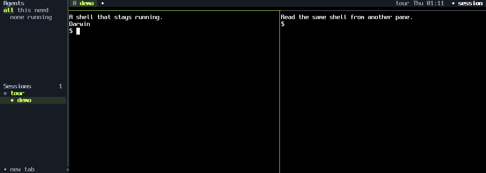

# phux


A terminal multiplexer whose server you can drive from code.

phux keeps your shells running in a background server and shows them in a
terminal UI, like tmux. Commands expose panes, input, snapshots, and agent
state with JSON output and exit codes. The server tracks which panes run
a coding agent and whether it is waiting on you. Another machine is one
`phux host add me@mini` away, with no account.

[Docs](./docs/README.md) · [Help](#help) · [Releases](https://github.com/no-phux/phux/releases) ·
[](https://github.com/no-phux/phux/actions/workflows/ci.yml)

## Install

### CLI and terminal UI

```sh
curl -fsSL https://phux.sh/install | sh
```

Or use [Homebrew](./docs/install.md#homebrew). Run `phux` after installing.

### Desktop app

**macOS:** [download the DMG](https://github.com/no-phux/phux/releases?q=desktop-v&expanded=true),
drag **Phux.app** to **Applications**, eject the image, and open Phux.
The app includes the CLI/server and is signed and notarized. Or install with
`brew install --cask no-phux/tap/phux-desktop` ([Homebrew setup](./docs/install.md#macos-homebrew)).
**Linux:** use the [desktop installer](./docs/install.md#desktop-app).
**Windows x64:** use the [PowerShell desktop installer](./clients/desktop/README.md#windows)
after setting up the WSL CLI/server.

### Platform support

| Platform | CLI / server / terminal UI | Desktop |
| --- | --- | --- |
| macOS, Apple silicon | macOS 11+ | macOS 26+ |
| Linux, x86_64 or arm64 | Native, glibc | X11 or Wayland, Vulkan driver |
| Windows | [WSL 2 and PowerShell launchers](./docs/install.md#windows-wsl) | Native x64 app, WSL 2 server |

[Other installation options](./docs/install.md). No Intel Mac or musl builds.

## Use

```sh
phux                      # start the server, attach; Ctrl-A is the prefix, Ctrl-A d detaches
phux ls                   # what is running
```

From a POSIX shell, with `jq` installed, create a **new shell pane** and drive
only that pane. No terminal UI needs to be attached:

```sh
(
  set -eu
  session="phux-demo-$$"
  created=$(phux new --json -s "$session" -- sh)
  pane="@$(printf '%s\n' "$created" | jq -er .terminal_id)"
  phux run --timeout 10 "$pane" 'printf "hello from phux\n"'
  phux snapshot "$pane"
  printf 'The shell is still running. From a terminal: phux attach %s\n' "$session"
)
```

`run` returns the command's output and exit status. Detaching or closing a
client leaves the shell running; attach to the printed session to take over.



*Recorded with phux. [Reproduce the capture](./scripts/record-readme.sh).*

[Getting started](./docs/getting-started.md) ·
[using phux as an agent](./docs/agent-quickstart.md) ·
[driving terminals from scripts](./docs/scripting.md) ·
[coding agents](./docs/agents.md) ·
[build on phux](./docs/building.md) ·
[remote machines](./docs/remote.md)

## For agents

Install phux and drive a session from code with
[Using phux as an agent](./docs/agent-quickstart.md).

phux knows which pane runs which agent and whether it is working, idle, or
blocked on you. Agents reach phux through plugins for Claude Code, pi, Oh
My Pi, OpenCode, and Grok, through the bundled MCP server (`phux mcp`), or
through the CLI. To hand the manual to your agent:

```text
Run `phux skill` and follow it to work with my phux terminals.
```

For an opt-in fleet setup, [Crew](./distros/crew/README.md) is the bundled
agent distro, with isolated homes, mission commands and
[distro switching](./docs/distros.md). It does not add a multi-host task
coordinator or autonomous delegation authority.

## Status

The core product is the persistent server, CLI and terminal UI. Remote
hosts, agent integrations, MCP, plugins and distros are maintained features
you can opt into; none is required for a local shell session.

The desktop app is a maintained, separately versioned client for macOS,
Linux and Windows; it is newer and rougher than the terminal UI. The browser
client is experimental and unshipped. Phone apps are in progress elsewhere,
not available downloads. [Clients](./docs/clients.md) covers their limits.
The wire protocol is `1.x`; any 1.x client works with any 1.x server. See
[protocol](./docs/protocol.md).

## Contributing

[CONTRIBUTING.md](./CONTRIBUTING.md), then [development](./docs/development.md).
phux is picky about new surface area; ask before building a feature.

## Help

- **Troubleshooting:** run `phux doctor`, then see [common fixes](./docs/troubleshooting.md) or [desktop recovery](./clients/desktop/README.md#first-launch-and-recovery).
- **Questions:** [Discord](https://discord.gg/dUv5rzdHp).
- **Bugs and proposals:** [GitHub issues](https://github.com/no-phux/phux/issues); [what to include](./docs/troubleshooting.md#reporting-a-bug).

## License

[Apache-2.0](./LICENSE). [NOTICE](./NOTICE) ·
[third-party notices](./THIRD-PARTY-NOTICES.md)
